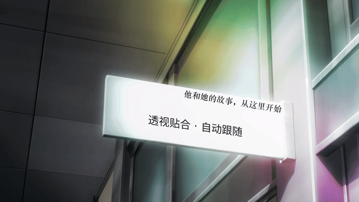

# Shotcut 表面贴字：下载与效果预览

用于把字幕投影到灯箱、招牌、屏幕、包装盒等物体的**单个平面**上，并随画面自动跟踪。包含 Shotcut 原生滤镜和中文本地跟踪助手。

## 直接看效果

下图为实际渲染结果的动态预览，新增的是灯箱下方的“透视贴合 · 自动跟随”。原视频已有文字被保留。

[下载 MP4 效果视频（约 1.1 MB）](https://github.com/megrezcai/w/raw/refs/heads/main/shotcut-surface-text/examples/preview.mp4) · [查看静态效果图](examples/preview.jpg)

## Windows 下载

| 文件 | 用途 |
| --- | --- |
| [Windows x64 完整部署包（约 70 MB）](https://github.com/megrezcai/w/raw/refs/heads/main/downloads/shotcut-surface-text-windows-x64.zip) | 普通使用者下载这个；包含滤镜、中文助手及 Python 运行环境，无需自行编译或安装开发工具 |
| [示例 Shotcut 工程（约 3.5 MB）](https://github.com/megrezcai/w/raw/refs/heads/main/downloads/surface-text-example.zip) | 含示例视频、透明字幕层和透视关键帧；先安装插件再打开 |
| [源码压缩包](https://github.com/megrezcai/w/raw/refs/heads/main/downloads/shotcut-surface-text-sources.zip) | 供开发者检查或修改；不包含 Windows Python 运行环境 |

也可直接浏览本目录中的源码。[下载文件的 SHA-256 校验值](../downloads/SHA256SUMS.txt)。

## 三步开始

1. 完整解压 Windows 部署包，关闭 Shotcut，双击 `Install-Plugin.cmd`，选择官方 Windows x64 Shotcut 的 `shotcut.exe`。推荐使用解压在可写目录的官方便携版。
2. 双击 `Start-Assistant.cmd`，在本机浏览器里打开视频。选清晰参考帧，按左上、右上、右下、左下选四角并保存，输入字幕，开始跟踪。
3. 检查效果并下载生成的工程 ZIP；完整解压后，用 Shotcut 打开 `surface-text.mlt`，继续剪辑和导出。

文字在独立透明轨道上，原视频和原声保留。改文案需要回到助手重新生成；四角关键帧可在 Shotcut 中修改。全部处理在本机进行，不需要 API 密钥。

## 当前验证状态

已在 Linux 验证跟踪、浏览器完整操作、MLT 原生渲染、Shotcut 滤镜面板，以及工程另存后字幕仍正确合成。示例从第 24 帧到片尾共 63 帧未触发跟踪丢失。

**Windows DLL 已编译，但 Windows 安装器及随包运行环境尚未实机验收，当前为可测试版本。**

适用于同一物体的单个平面；不包含曲面贴图、自动去除原字幕、前景遮挡分割或光照匹配。遮挡、模糊或离开画面可能导致跟踪丢失，需要补充人工修正点。

完整说明、源码构建、限制和删除方法见 [README.md](README.md)。
